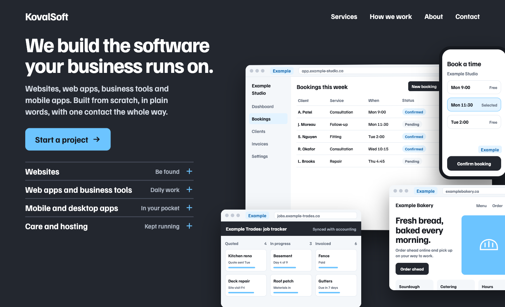

# KovalSoft

We build websites, web apps, business tools and mobile apps from scratch, in plain words, with one point of contact. Based in Ontario.

## What we build

- Websites that earn trust and bring in inquiries
- Web apps and business tools, such as booking systems, client portals and internal dashboards
- Mobile and desktop apps
- Care and hosting, for what we've built and for sites nobody is looking after

## How working with us goes

1. We talk. The first conversation is free.
2. We plan and quote. You get a written plan and a fixed quote before anything is built.
3. We build, and send regular progress updates.
4. We launch, hand over and walk you through it.

We work remotely with clients anywhere, and meet in person locally when it helps.
